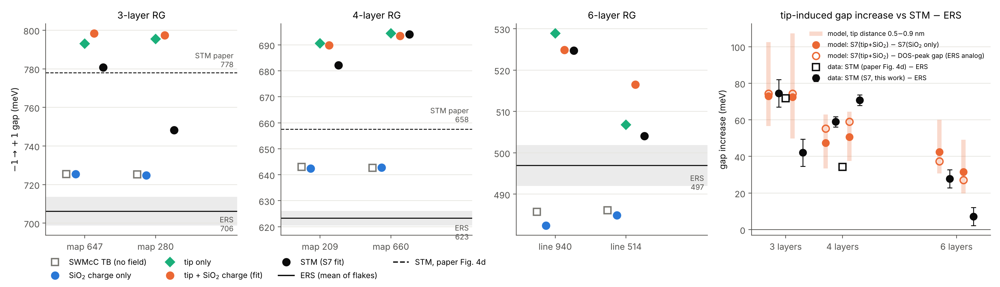
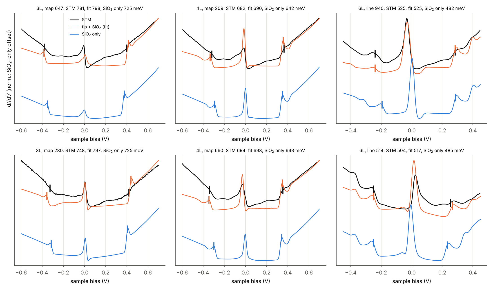

# Tip-induced band bending and the −1 → +1 gap of rhombohedral graphite (3, 4 and 6 layers)

Question: the STM gap between the −1 and +1 band edges of rhombohedral graphite (RG) is 30–70 meV larger than the ERS
gap of the same thickness (Pálinkás et al., Carbon 230, 119608 (2024), Fig. 4d: 3L 778 vs 706 meV, 4L 658 vs 623 meV).
How much of this excess is tip-induced band bending (TIBB)?

Answer: TIBB accounts for the excess in magnitude and in its thickness dependence. With the tip and SiO2-charge
parameters fitted to the measured spectra, TIBB inflates the S7 gap by 73 meV (3L), 47–51 meV (4L) and 32–43 meV (6L)
at d = 0.7 nm; the SiO2 charge alone changes the gap by at most 4 meV. The measured STM − ERS excess is 72–75 meV
(3L: map 647 and the paper's all-pixel value; map 280 gives 42 meV), 34–71 meV (4L, depending on the S7 fit
implementation) and 7–28 meV (6L). Model TIBB and measured excess agree within ±25 meV with no systematic sign (except
3L map 280, −31 meV), which is the size of
the S7 fit systematics and of the offset between the SWMcC tight-binding gap and the ERS gap (+18, +11, −7 meV for 3,
4, 6 layers). An excitonic or other correction of more than ~20 meV is not required by these data.





## Gap definition

Supplementary S7 of the paper (`lin_step_gauss_lin` of the Zenodo notebook "fitting STM gaps"): two linear backgrounds
plus a sigmoid step and a Gaussian, both centred on x0, fitted around each band edge; gap = x0(+1) − x0(−1). The same
fit is applied to measured and simulated spectra (`analysis/s7.py`, multi-start over x0 so it runs unattended).
Windows: 3L (−0.6, −0.15) / (0.2, 0.7) V, 4L (−0.6, −0.2) / (0.2, 0.7) V (the notebook's); 6L ±1 edges are only
~100 mV from the ±2 edges, so the windows are anchored on the −1 peak and the +1 rise of each spectrum
(`features.features` of kandrai2026_rg_tip_gating): (peak − 50, peak + 90) mV and (rise − 70, rise + 60) mV.

## Model

Self-consistent Hartree + full-SWMcC tight binding (bandbending engine, branch `lateral-solver`; McEllistrim 2023
parameters), identical to kandrai2026_rg_tip_gating: neutral stack, interlayer eps_z 2.6, 2 nm SiO2 trap layer with
fixed charge n_sub on 88 nm SiO2, grounded Si gate, tip R 20 nm, d 0.7 nm, contact potential CPot; T 9 K; WKB 4.6 eV.
Broadening sigma 10 meV (3L/4L), 12.5/13.7 meV (6L, as fitted there). Lock-in modulation per map (2.5–5.5 mV).

Cases:
- **SWMcC TB**: neutral stack, no field (U = 0).
- **SiO2 charge only**: tip-free self-consistent solve with the fitted n_sub (bias-independent potentials).
- **tip only**: fitted CPot, n_sub = 0, full bias sweep.
- **tip + SiO2 charge**: fitted CPot and n_sub, full bias sweep (the fit).
- **ERS analog**: separation of the −1 and +1 peaks of the total DOS (Gaussian 3 meV) with the SiO2 charge, no tip.

Fits. 3L / 4L (this folder): the flat-band peak, x0(−1) and x0(+1) of the map-averaged spectrum; 5 × 3 grid
CPot ∈ {−0.3, −0.15, 0, 0.15, 0.3} eV × n_sub ∈ {−0.5, 0, 0.5}e13 cm⁻², thin-plate interpolation, verification sweep at
the optimum. 6L: the published (+5) fits of kandrai2026_rg_tip_gating (four peak positions).

| sample | CPot (eV) | n_sub (1e13 cm⁻²) | verified rms of FB, x0(−1), x0(+1) (mV) |
|---|---|---|---|
| 3L map 647 | +0.040 | +0.075 | 12.2 |
| 3L map 280 | −0.030 | −0.200 | 20.5 |
| 4L map 209 | −0.210 | −0.175 | 11.3 |
| 4L map 660 | −0.270 | −0.075 | 5.3 |
| 6L line 940 | −0.615 | −0.500 | 1.5 |
| 6L line 514 | +0.370 | +0.375 | 8.6 |

The interpolated rms at the optimum is 1–6 mV for three of the four thin maps; the verified values are larger because
the flat-band peak of 3L (a peak plus a sharp edge in the top-layer LDOS) is a fragile argmax target. The (CPot, n_sub)
valley is degenerate (`thin/fit.json`, `valley_*`), but the model gap varies by < 10 meV along it.

## Results (meV)

| sample | STM (S7) | ERS | TB | SiO2 only | tip only | tip + SiO2 | TIBB = (tip + SiO2) − SiO2 | TIBB at d = 0.5 / 0.9 nm | STM − ERS |
|---|---|---|---|---|---|---|---|---|---|
| 3L map 647 | 780.7 | 706.1 | 725.4 | 725.4 | 793.0 | 798.4 | **+73.0** | +102.6 / +56.6 | +74.6 |
| 3L map 280 | 748.2 | 706.1 | 725.3 | 724.8 | 795.5 | 797.4 | **+72.6** | +107.3 / +49.8 | +42.1 |
| 4L map 209 | 682.2 | 623.3 | 643.0 | 642.4 | 690.6 | 689.8 | **+47.4** | +62.9 / +33.4 | +58.9 |
| 4L map 660 | 694.1 | 623.3 | 642.7 | 642.7 | 694.4 | 693.5 | **+50.8** | +64.5 / +37.5 | +70.8 |
| 6L line 940 | 524.7 | 497.0 | 485.7 | 482.4 | 528.9 | 524.9 | **+42.5** | +60.0 / +30.6 * | +27.7 |
| 6L line 514 | 504.1 | 497.0 | 486.1 | 484.9 | 506.8 | 516.5 | **+31.6** | +49.1 / +19.7 * | +7.1 |

STM (S7): fit of the map-averaged spectrum (3L, 4L) or of the (+5) line spectrum (6L) with `s7.py`.
ERS: mean of the flakes in the Zenodo notebook "ers all flakes" (3L: 4 flakes, 4L: 3, 6L: 1).
\* 6L distance sensitivity transferred from the kandrai2026 geometry sweep of line 940 (CPot −0.367 eV, n_sub 0).
Paper STM values (all pixels of both maps, Fig. 4d): 3L 777.9 (STM − ERS +71.8), 4L 657.6 (+34.3).
ERS-analog model gaps (DOS peaks, SiO2 charge): 3L 724.0 / 723.0, 4L 634.5 / 634.5, 6L 487.5 / 489.5;
TB DOS-peak gaps 724.0, 634.5, 490.5 (McEllistrim 2023: 634 for 4L).

Mechanism: the gap inflation equals the difference of the layer-averaged apex potential at the two edge biases
(3L 76/73, 4L 48/51, 6L 50/33 meV against TIBB 73/73, 47/51, 42/32 meV): at |V| ≈ 0.3–0.4 V only the flat band can
screen the tip field and it is emptied or filled within tens of mV, so the stack follows the tip with a lever arm of
~0.1 (3L) that falls with thickness. The gap increase depends only weakly on CPot, because TIBB is roughly linear in
V − V0 and the two edges lie on opposite sides of V0 (n_sub = 0, CPot −0.3 … +0.3 eV: 3L 65–83 meV, 4L 34–54 meV), and
the SiO2 charge changes it by ≤ 11 meV (tip only − TB against tip + SiO2 − SiO2 only).

## Caveats

- **Tip–sample distance** is the dominant model uncertainty (d = 0.7 nm is the convention of kandrai2026): d = 0.5–0.9 nm
  spans 50–107 meV (3L), 33–65 meV (4L), 20–60 meV (6L). Tip radius matters little (6L, R 5 → 80 nm: 23 → 32 meV).
- **S7 systematics in the data**: the per-pixel STM gap depends on the fit implementation by up to ~40 meV
  (`pixel_s7.json`: multi-start per pixel 3L 809 / 759, 4L 702 / 681 mV; the paper's single-start fits 779 / 756,
  695 / 616 mV; map-averaged spectra 781 / 748, 682 / 694 mV). The model is compared with the map-averaged spectra,
  fitted by the same code.
- 3L map 280 is not reproduced: its gap (748 mV) lies below every tip model at d = 0.7 nm (the fit gives 797 mV); it
  would need d ≈ 1 nm or a blunter / differently terminated tip. 6L line 514: model 12 meV above the data.
- ERS is measured at room temperature on other flakes; the model ERS analog has no excitonic term. TB − ERS offsets of
  +18 / +11 / −7 meV (3 / 4 / 6 layers) bound what the SWMcC parameters can resolve.

## Layout and running

Requires the `bandbending` package (branch `lateral-solver`, `pip install -e .`), `rhkpy` (sm4 files) and the Zenodo
dataset 10.5281/zenodo.10931524 unpacked at `$ZENODO_10931524`; the 6L scripts import
`bandbending/examples/kandrai2026_rg_tip_gating/analysis` (`$KANDRAI_ANALYSIS`, default: the sibling checkout).

- `report.html`: the full report (self-contained; `python make_report.py`)
- `data/stm_3L4L_avg.json`: map-averaged dI/dV of the four 3L/4L maps (`avg_spectra.py`)
- `results/`: the two figures
- `analysis/`: scripts; cached sweeps (`thin/sweep_*.json`, `six/`) let every stage after the solves rerun in seconds

```
python repro_s7.py                 # S7 per-pixel statistics with the notebook's settings (paper numbers)
python pixel_s7.py                 # the same with the multi-start fitter
python avg_spectra.py              # map-averaged spectra -> data/
python grid.py                     # 3L/4L (CPot, n_sub) grid of bias sweeps (4 processes, ~1.5 h)
python thin_fit.py fit             # optimum per map from the grid
python thin_fit.py final           # verification, tip-only and d = 0.5/0.9 nm sweeps (4 processes, ~40 min)
python thin_fit.py decomp          # TB / SiO2-only / tip-only / tip+SiO2 S7 gaps -> thin/gap_*.json
python six_tiponly.py              # 6L best-fit CPot with n_sub = 0 (2 processes, ~15 min)
python six_gap.py 940; python six_gap.py 514
python dos_gap.py 3:0.075:3L_647_sub ...   # ERS-analog DOS-peak gaps (N:n_sub/1e13:key)
python make_figure.py
python make_report.py              # report.html
```
